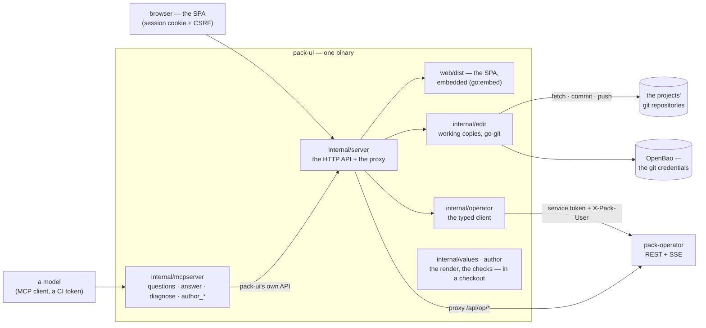
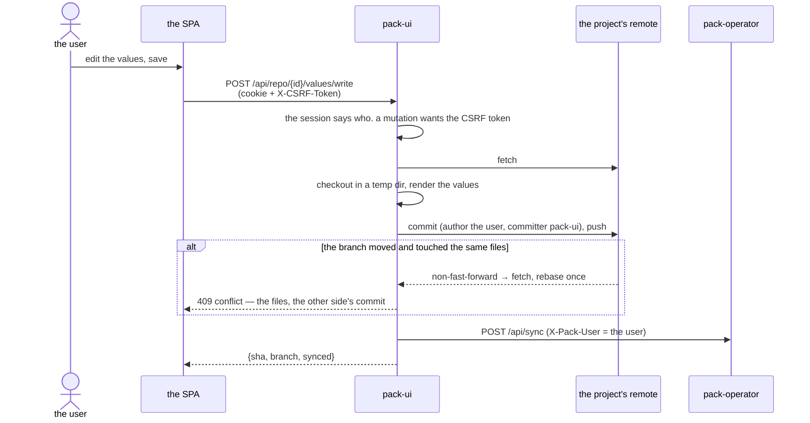

# The architecture of pack-ui

pack-ui is the person's window on pack — one binary that is two clients at once:

- **the operator's API client.** Everything the UI shows of releases, requests, jobs, changes and secrets
  comes from the operator's REST API (К4), either through the typed client (`internal/operator`) or through
  the reverse proxy the SPA calls at `/api/op/*`.
- **the git client of the users' edits.** Every write the UI makes becomes a commit in the project's
  repository — authored by the user, committed by pack-ui, pushed, and followed by a request to the
  operator to sync (К5). go-git only; there is no `git` binary.

A second mode of the same binary, `pack-ui mcp`, is an MCP server on stdio: a model works the values of a
release and the source of a pack through pack-ui's own API ([mcp.md](mcp.md)).

## The whole picture

## The packages

| package              | what it is                                                                                       |
|----------------------|--------------------------------------------------------------------------------------------------|
| `cmd/pack-ui`        | the binary: the HTTP server; `pack-ui mcp` the MCP server                                         |
| `internal/config`    | the configuration file, the defaults, the refusals at load ([configuration.md](configuration.md)) |
| `internal/server`    | the HTTP handlers: the SPA, the API, the auth middleware, the proxy                               |
| `internal/edit`      | the working copies: read, log, diff, checkout, write with the rebase ([editing.md](editing.md))   |
| `internal/operator`  | the typed client of the operator's API; the Failure document                                       |
| `internal/values`    | a release in a checkout: the live help, the render ([values.md](values.md))                        |
| `internal/author`    | the pack's source: detect, generate, locate, scaffold ([authoring.md](authoring.md))               |
| `internal/authn`     | the sessions (in memory, 24 h), the bcrypt login, the OIDC flow                                    |
| `internal/mcpserver` | the MCP tools over pack-ui's own API                                                              |
| `web/`               | the SPA ([web.md](web.md))                                                                        |

## The request path

Two rules shape everything:

- **The browser knows pack-ui only.** The operator's address never reaches the page: the proxy at
  `/api/op/*` rewrites to the operator's `/api/*`, asserts the session's user as `X-Pack-User`, attaches
  pack-ui's service token, and drops the cookie. SSE (the job and saga streams) flows through unbuffered
  and resumable by `Last-Event-ID`.
- **pack-ui holds no rights of its own.** Who the user may be, what they may do — the operator's policy
  (casbin) decides every proxied and every typed call. pack-ui's own API only edits repositories and
  renders; the secrets it ever names are a reference, never a value.

## The working copies

Every project has one working copy under `repos/<id>`, cloned on first use, fetched on every request, and
used under a per-project lock — a worktree serializes its edits. The credentials come from the same secrets
store the operator reads (OpenBao: `secrets.provider`). The renders and the checks never touch the working
copy: they run on a throwaway checkout of the branch's head in a temp directory, removed when the request
is done.

## Authentication (C9)

- `auth: none` — every request is the configured `user` (the development default).
- `auth: local` — `POST /api/login` against the bcrypt hashes of the configured users.
- `auth: oidc` — the provider's authorization-code flow; at login the groups, mapped by `oidc.groups`, are
  granted as roles in every project through the operator's `/api/grants` (pack-ui's service token is an
  admin's).

A login opens a session: an `HttpOnly`, `SameSite=Lax` cookie (`pack_ui_session`), 24 hours, kept in
memory — a restart logs everyone out. A mutating call with the cookie wants the session's `X-CSRF-Token`.
A CI or a model carries a bearer of the configuration's `tokens:` instead — no session, no CSRF.

What is a person's stays a person's: no endpoint and no MCP tool approves a deploy or merges a change, and
no secret's value is ever read.
