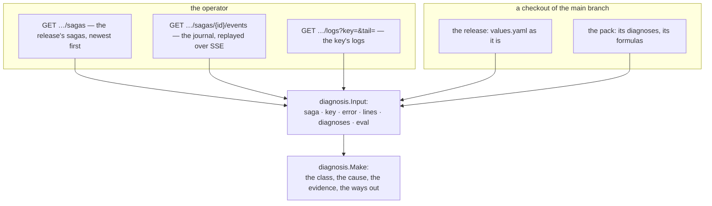

# Diagnosis: the case of a failed saga

```
POST /api/repo/{id}/diagnose   {path, saga?, key?, logs?, lang?}
```

The case of a release's failure, assembled as `pkg/diagnosis` works it: what class the failure is, its
cause, the evidence, and the ways out. Nothing here runs anything — the ways out come back as **data** and
what happens next is a person's.

## Where the pieces come from



- `saga` empty — the newest; `key` empty — the saga's own failed node (the last event with
  `status: failed`).
- The evidence is the journal's lines of the node plus the tail of its logs (50 lines of each instance;
  `logs: false` leaves them out).
- The pack's own diagnoses of the failed key come from the checkout; each one's `when` and each fix's
  formula is evaluated on **the values as the file holds them**, the target a stub.

## The ways out

Each way out is one of:

- **a patch** — values worked out by a fix's formula. The UI offers it; the person confirms, and only then
  is it written — through the values endpoints, as a commit with a message ([values.md](values.md)).
- **a command** — something a request of the operator runs (`POST /api/releases/{rel}/requests`, proxied).
  pack-ui never runs it.

A release that ran no saga yet is a 404 `not_found` ("nothing to diagnose"); a saga without a failed node
the same. The operator's side failing is a 502.
