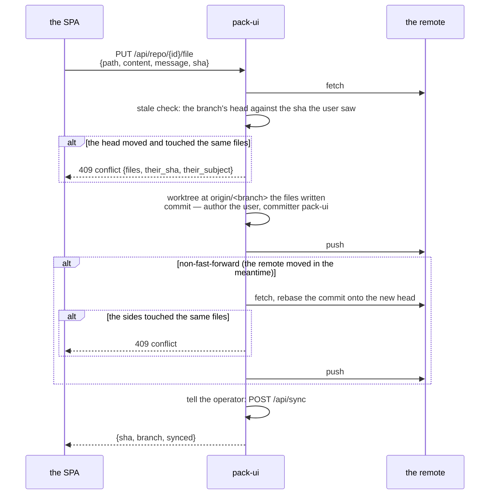

# Editing: the git client of the users' edits

`internal/edit` is pack-ui's half of К5: a person's change of a repository is a commit **authored by the
user**, committed by pack-ui (`git.committer`), pushed, and told to the operator. Only the git protocol —
go-git, no `git` binary.

## The working copies

Each project has exactly one working copy, `repos/<id>`:

- cloned on first use (the credentials, when the project names them, from the secrets store — OpenBao);
- fetched on **every** request, so what the UI shows is what the remote holds;
- used under a per-project lock — a worktree serializes its edits;
- reads resolve against `refs/remotes/origin/<branch>`.

The renders and the author checks never run in the working copy: `Repo.Checkout` writes the tree of a
branch's head into a temp directory without a `.git` of its own, and the caller removes it.

## A write, end to end

Three guarantees:

1. **Nothing is silently overwritten.** The client sends the sha its edit was based on (a read answered
   it). When the branch moved since and any of the moved files is among the files being written, the write
   is refused before anything is committed — a `*Conflict`, HTTP 409, naming the files and the other
   side's commit. The user rebases: reads the file again, reapplies, writes again.
2. **A race is rebased once.** A push the remote refuses (it moved between fetch and push) is fetched and
   rebased onto the new head — but only when the files each side changed are disjoint. When they are not,
   it is again a `*Conflict`.
3. **The commit is the user's.** `Author` is the session's user (`alice <alice@localhost>`), `Committer`
   is `git.committer`. The history says who changed what; pack-ui only signs that it did the typing.

A path stays in the repository: `..` and absolute paths are refused.

## flow: direct and flow: review

The project's `flow` ([configuration.md](configuration.md)) decides where a write lands:

- `direct` — the commit is pushed to the main branch (`branch:`), the operator syncs, the release's head
  moves.
- `review` — every write endpoint (`PUT file`, `values/write`, `init`, `author/scaffold`) refuses a body
  without `branch`; the commit goes to the change request's branch. The branch itself is opened by the
  operator (`POST /api/changes`, proxied), the diff of the request is `GET /api/repo/{id}/diff` against the
  merge-base, and the merge is the operator's — pack-ui never merges.

## The reads

| endpoint | what it answers |
|---|---|
| `GET /api/repo/{id}/file?path=&ref=` | the file at the branch's head (`ref` empty — the project's main branch), and the head's sha — the sha a write is based on |
| `GET /api/repo/{id}/log?path=&ref=` | the commits that touched the path (a release's directory), newest first, at most 50 — the release card's "commits of the directory" |
| `GET /api/repo/{id}/diff?base=&head=` | the change of `head` against where it left `base` (the merge-base): each file's content before and after; a file over a megabyte either side is said, not carried |

## The sync after a push

A write that landed asks the operator to sync (`POST /api/sync`, the typed client). A failed sync does
**not** fail the write — the commit is on the remote and the operator's own interval retries; the answer
says `synced: false` and the log says why. `init` is the exception: it waits for the operator to know the
release and then asks for the `refresh` request that locks the pack ([api.md](api.md)).
