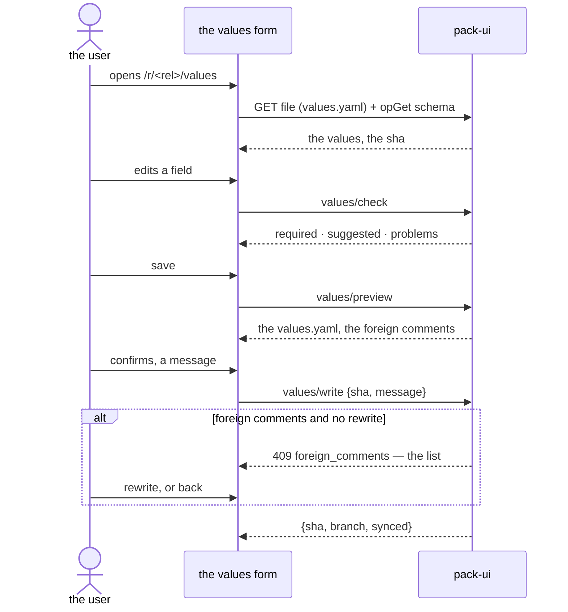

# The values work

The values of a release are written by pack-ui, but rendered exactly as `pack values write` renders them
(`pkg/valuesfile`) — the file the repository gets is byte for byte the CLI's. All three endpoints work on a
throwaway checkout of the branch's head, never in the working copy.

## What a release is here

`values.Load(checkout, path)` reads the release's directory: `release.yaml` (the pack, the installation
id), the `values.yaml` it has now. Two refusals:

- **the pack is an OCI reference** — a release whose pack is not a directory of the repository is not
  rendered here (the operator's checkout renders it);
- **a whole document** — a `values.yaml` with `values:`, `rollout:` or `skip:` is written by hand, not
  here: a write would lose the rest (`pack values write` refuses the same).

The render's context is the release alone: the target is a stub (`StubTarget` — a key resolves to its own
name), there are no facts. A suggestion that reads the environment offers nothing here; the help is the
schema's, not the environment's.

## The three endpoints

### `POST /api/repo/{id}/values/check` — the live help

```json
{"path": "releases/prod/db", "values": {"conf": {"port": 5432}}, "lang": "ru"}
```

What the values as the form holds them still ask (`render.Ask` — the fill the pack asks for): the settings
required and missing, the suggestions the pack makes for them, the problems — every one pointing where the
schema points. The SPA's form calls it as the user types.

### `POST /api/repo/{id}/values/preview` — the file it would be

```json
{"path": "releases/prod/db", "values": {…}, "lang": "ru"}
```

Answers `{content, foreign}`: the `values.yaml` the values would be written as, and the **foreign
comments** — the comments of the file it has now that the render would lose.

### `POST /api/repo/{id}/values/write` — the commit

```json
{"path": "releases/prod/db", "values": {…}, "message": "port 5433", "lang": "ru", "sha": "…", "branch": "cr-12"}
```

Renders, commits `<path>/values.yaml` as the user, pushes, syncs — the write of
[editing.md](editing.md), with one refusal of its own:

- `foreign_comments` (409) — the file has comments the render would lose. The detail lists them; the user
  either re-sends with `rewrite: true` (the comments are lost knowingly) or puts the values back by hand.

`message` is required — every change of the repository is a commit a person reviews, and the message is
what they review. `sha` is the head the form was read at (the stale check); `branch` is required when the
project is `flow: review`.

## The flow in the SPA


